|  |
| --- |
|  |

|  |
| --- |
|  |

|  |
| --- |
|  |

|  |
| --- |
| BoxLift |

|  |
| --- |
| Simulation package |

**Table of contents**

Um das Inhaltsverzeichnis zu generieren, platzieren Sie den Cursor auf diesem Feld und drücken Sie die Taste F9.

**Requirements**

|  |  |  |  |  |  |  |  |  |  |  |
| --- | --- | --- | --- | --- | --- | --- | --- | --- | --- | --- |
| | **Requirements** |  | | --- | --- | | Basic knowledge | Basic technical understanding | | Training modules | TM210 Working with Automation Studio  TM246 Structured Text  TM611, TM671 Working with mapp View (optional)  TM415, TM416 Programming with mapp Motion (optional) | | Software | Automation Studio 6  RobotStudio 2026 | | Hardware | ArSim or X20CP1686X (any hardware possible) | |

1. **Package contents**

The BoxLift simulation package contains the following files (BoxLiftPackage-GER.zip):

| **File** | **Description** |
| --- | --- |
| BoxLiftSimulationPackage.pdf | Module description and task definitions (this document) |
| RS QuickStartGuide.pdf | Short description on   Installing and licensing RobotStudio   Creating the OPC UA connection between RobotStudio and Automation Studio. |
| BoxLift.rspag | RobotStudio Pack & Go file for loading the model |
| AutomationStudioFiles.zip | Import package for Automation Studio to communicating with the RobotStudio model. |
| BoxLiftSampleProject.zip | AutomationStuio project with solution for tasks |

1. **BoxLift model description**

* 1. **Model overview**

The BoxLift simulation model consists of several programmable elements, which are briefly introduced below.

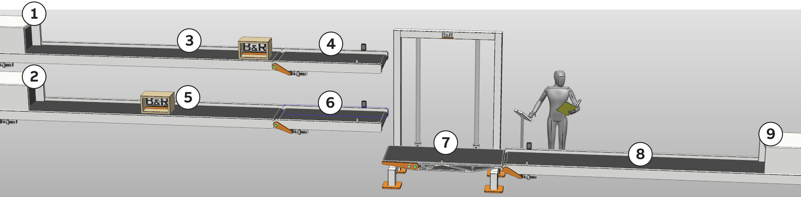

Figure 1: Overview of the simulation model elements

|  | **Description** | **Description** |
| --- | --- | --- |
| 1 | Top source for boxes | Boxes are produced at regular intervals |
| 2 | Bottom source for boxes | Boxes are produced at regular intervals |
| 3 | Upper entry conveyor belt | Transport of the boxes from the source to the feeder conveyor belt (top) |
| 4 | Top feeder conveyor belt | Transport of boxes from the source conveyor belt to the lift (top) |
| 5 | Lower entry conveyor belt | Transport of boxes from the source to the feeder conveyor belt (bottom) |
| 6 | Bottom feeder conveyor belt | Transport of the boxes from the source conveyor belt to the lift (bottom) |
| 7 | Lift | Changing levels is possible with the lift (3 levels: Top, bottom, unloading) |
| 8 | Unloading conveyor belt | Removal of the boxes after the lift to the sink |
| 9 | Sink for boxes | Boxes that arrive here disappear again in the model |

* 1. **Overview of OPC UA variables**

This chapter describes the data points that are exchanged between the simulation model in RobotStudio and the SimConnect task in Automation Studio when an OPC UA connection is established.

* + 1. **SimConnect task variables**

|  |  |  |  |  |
| --- | --- | --- | --- | --- |
| In the SimConnect program, there are two structure variables SimInputs and SimOutputs, which combine the input and output elements of the simulation model:   **SimInputs** (SimInputsType)   **SimOutputs** (SimOutputsType)  The individual elements of the both structure variables are the data points communicated with the simulation model (via OPC UA).  In the BoxLift simulation model, the variable values shown on the right are exchanged with the simulation model.   |  |  | | --- | --- | |  | The individual elements of the structure variables can be linked to other local (or global) variables of the project via PV mapping. | |  | 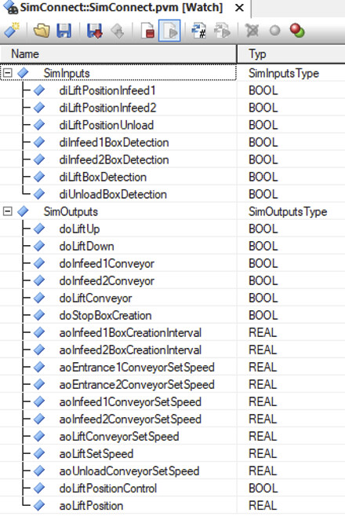  Figure 2: SimConnect task variables |

|  |  |
| --- | --- |
|  | [Programming \ Editors \ Configuration editors \ Variable mapping editor](https://help.br-automation.com/#/de/4/programming%2Fconfiguration%2Fvariablemapping%2Feditors_configuration_variablemapping.html) |

The following description of the function of the variables in the model should help to correctly and sensibly assign the structural elements of the SimConnect variable in the PV mapping.

* + 1. **Digital output variables**

|  |  |  |
| --- | --- | --- |
|  | 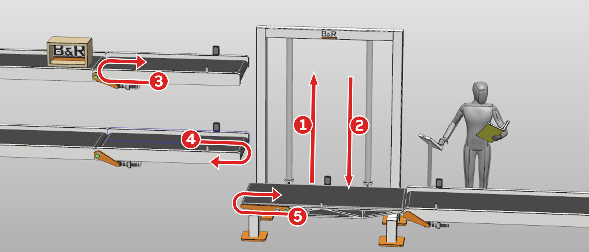  Figure 3: Assignment of the communicated digital output variables to the model |  |

|  | **Variable name**  **(in the SimConnect task)** | **Data type** | **Meaning** |
| --- | --- | --- | --- |
| 1 | SimOutputs.doLiftUp | BOOL | Moves lift to the top |
| 2 | SimOutputs.doLiftDown | BOOL | Moves lift down |
| 3 | SimOutputs.doInfeed1Conveyor | BOOL | Starts and stops the top feeder conveyor belt |
| 4 | SimOutputs.doInfeed2Conveyor | BOOL | Starts and stops the bottom feeder conveyor belt |
| 5 | SimOutputs.doLiftConveyor | BOOL | Starts and stops the conveyor belt of the lift |
|  | SimOutputs.doStopBoxCreation | BOOL | Stop / start box generation |
|  | SimOutputs.doPositionControl | BOOL | Switch to position control of the lift (mapp Motion) |

* + 1. **Digital input variables**

|  |  |  |
| --- | --- | --- |
|  | 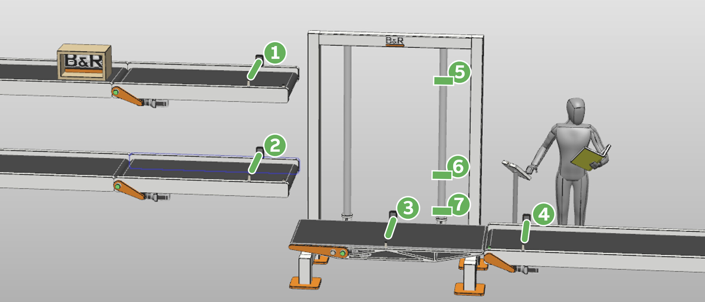  Figure 4: Assignment of the communicated digital input variables to the model |  |

|  | **Variable name**  **(in the SimConnect task)** | **Data type** | **Meaning** |
| --- | --- | --- | --- |
| 1 | SimInputs.diInfeed1BoxDetection | BOOL | Light barrier for detecting a box on the top feeder conveyor belt |
| 2 | SimInputs.diInfeed2BoxDetection | BOOL | Light barrier for detecting a box on the bottom feeder conveyor belt |
| 3 | SimInputs.diLiftBoxDetection | BOOL | Light barrier for detecting a box on the lift |
| 4 | SimInputs.diUnloadBoxDetection | BOOL | Light barrier for detecting a box on the unloading conveyor belt |
| 5 | SimInputs.diLiftPositionInfeed1 | BOOL | Lift position sensor (lift on the top feeder conveyor belt) |
| 6 | SimInputs.diLiftPositionInfeed2 | BOOL | Lift position sensor (lift on bottom feeder conveyor belt) |
| 7 | SimInputs.diLiftPositionUnload | BOOL | Lift position sensor (lift on unloading conveyor belt) |

* + 1. **Analog output variables**

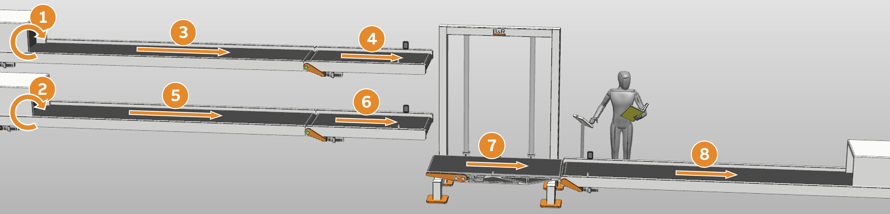

Figure 5: Assignment of the communicated analog output variables to the model

|  | **Variable name**  **(in the SimConnect task)** | **Data type** | **Meaning** | **Init value** |
| --- | --- | --- | --- | --- |
| 1 | SimOutputs.aoInfeed1BoxCreationInterval | REAL | Generation interval upper boxes | 20 |
| 2 | SimOutputs.aoInfeed2BoxCreationInterval | REAL | Generation interval lower boxes | 25 |
| 3 | SimOutputs.aoEntrance1ConveyorSetSpeed | REAL | Upper entry conveyor belt speed | 0.6 |
| 4 | SimOutputs.aoInfeed1ConveyorSetSpeed | REAL | Top feeder conveyor belt speed | 0.7 |
| 5 | SimOutputs.aoEntrance2ConveyorSetSpeed | REAL | Lower entry conveyor belt speed | 0.5 |
| 6 | SimOutputs.aoInfeed2ConveyorSetSpeed | REAL | Bottom feeder conveyor belt speed | 0.7 |
| 7 | SimOutputs.aoLiftConveyorSetSpeed | REAL | Lift conveyor belt speed | 0.9 |
| 8 | SimOutputs.aoUnloadConveyorSetSpeed | REAL | Unloading conveyor belt speed | 0.9 |
|  | SimOutputs.aoLiftSetSpeed | REAL | Lift travel speed | 0.6 |
|  | SimOutputs.aoLiftPosition | REAL | Lift position specification (mappMotion) | 0.0 |

1. **BoxLift - Basic version**

* 1. **Description**

Conveyor belts at two different levels (top and bottom) transport boxes to a light barrier at the end of the respective feeder conveyor belt. The boxes waiting there are then picked up by a lift, which takes them down to a third unloading conveyor belt that transports the boxes away.

The process is fully automatic, no user interaction is required.

The speeds of the conveyor belts and lift are constant and do not need to be adjusted. The lift is operated via digital output signals.

* 1. **Possible approach**

1) Create a program for your application and declare all the required digital input and output variables locally.

2) Create a variable mapping (.pv file in the configuration view) for all digital input and output variables of your application task to the corresponding variables of the SimConnect task.

3) Create a state machine that describes the functionality of the basic version of the BoxLift.

4) Program the functionality of the basic version using an enumeration data type that contains the different states.

1. **BoxLift with mapp View**

* 1. **Description**

In addition to the functionality of the basic version, a minimum two-page HMI application should be created. The HMI application contains elements for displaying and controlling some of the variable values communicated with the simulation model. In addition to the speed values of the conveyor belts and the production rate of both box sources, the current machine status and the number of boxes successfully transported to the unloading conveyor belt should also be displayed.

Write access to variables is partially restricted depending on user authentication:

 An unauthorized user (no login) should be able to start and stop the creation of the boxes in the model and reset the system status via the HMI application.

 A logged-in user is also permitted to reset the current number of boxes counted and change the production rate of the boxes.

 A user with the service role also has the right to adjust the speeds of all conveyor belts.

* 1. **Possible approach**

1) If you are not yet familiar with the creation of mapp View HMI applications, work through TM611 and TM671.

2) Think about a clear and user-friendly layout that meets the requirements of the task.

3) Create a two-page HMI application that uses this layout. Both the page change and the user login should be equally possible regardless of the selected page and should therefore be located in concurrently managed areas. A login via a dialog box is recommended.

4) Create the users and roles required for the task and restrict the write permissions for the variables in the "OpcUaMap.uad" file in Automation Studio accordingly.

5) Enable all variables of the local control task that occur in the HMI application in the "OpcUaMap.uad" and adjust the access rights according to the task.

|  |  |
| --- | --- |
|  | **Important!**  RobotStudio is also affected by a restriction of write access to OpcUa variables that are exchanged between the controller and the simulation model. A user with the appropriate rights must then also be stored here for communication! |

**Customizing user rights for OpcUa communication in RobotStudio**

If write access to OpcUa variables on the OpcUa server running on the controller is linked to user authentication, this must also be taken into account when communicating with RobotStudio.

The following steps are required to create a user with a password for communication in RobotStudio:

|  |  |  |
| --- | --- | --- |
| 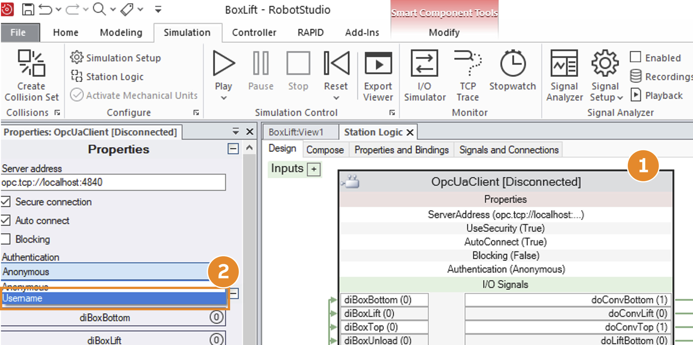  Figure 6: Replace anonymous user |  |  |
|  | 1) Double-click on the gray area of the OpcUaClient block in StationLogic. The properties of the block open on the left.  2) Change "Authentication" from "Anonymous" to "Username". |

|  |  |  |
| --- | --- | --- |
| 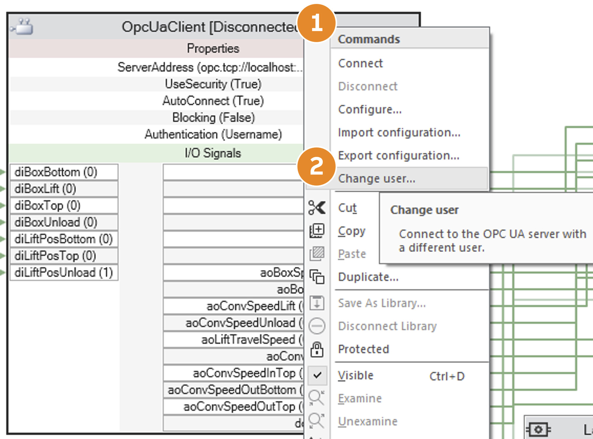  Figure 7: User change for OpcUa communication in RobotStudio |  | 1) Right-click on the block (gray area)  2) Select "Disconnect" and then "Change user" |
| The next time RS attempts to connect to the configured OpcUa server ("Connect"), the user query appears. Enter a user here who has write and read access to all variables exchanged with the simulation model. |
| 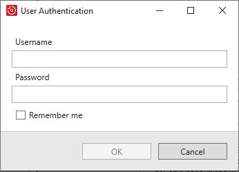  Figure 8: RobotStudio authentication window |

1. **BoxLift with mapp Motion**

* 1. **Description**

In addition to the functionality of the basic version, the up and down movement of the lift should be implemented using a drive with a linear axis.

Instead of the previously digital movement commands used for the lift (doLiftUp and doLiftDown), the lift should be controlled via absolute positioning commands of a mapp Motion single axis.

The rest of the application from the basic version should remain unchanged.

* 1. **Possible approach**

1) If you are not yet familiar with the creation of mapp View HMI applications, work through TM415 and TM416.

2) Add drive hardware (real or to simulate) to your project.

3) Consider practical modularization of your application between BoxLift logic and motion application.

4) Create the necessary configuration files and variables for using a mappMotion single axis.

5) Connect the current position value of block MpAxisBasic to SimOutputs.aoLiftPosition.

6) Consider what information needs to be exchanged between the axis application and BoxLift logic.

7) Consider a state diagram to control the axis.

|  |  |
| --- | --- |
|  | **Important!**  The Position output of the MpAxisBasic block cannot be connected directly to SimOutputs.aoLiftPosition. This is only possible by using an additional variable as a communications medium. |

|  |  |
| --- | --- |
| 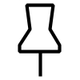 | **Important!**  If no real hardware is available, make sure that the drive simulation is also switched on in the drive hardware configuration. |

1. **Solution notes**

**State machine**

The following state machine can be used for the fully automated BoxLift process in the basic version.

The variable identifiers for the digital input signals (diInfee1BoxDetection,...) are the names of the variables of the local control task from the BoxLiftSampleProject.

The names of the states (WAIT, TO\_INFEED1\_POSITION, ...) correspond to the elements of the enumeration data types (enumeration) of the BoxLiftSampleProject declared in the control task.

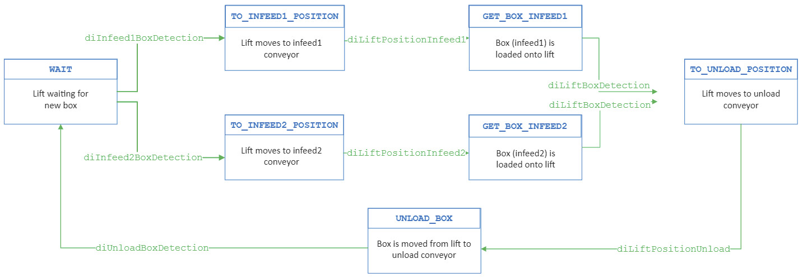

Figure 9: BoxLift state machine

The following state diagram can be used to control the lift using a linear axis with mapp Motion. Any error handling required is not taken into account here.

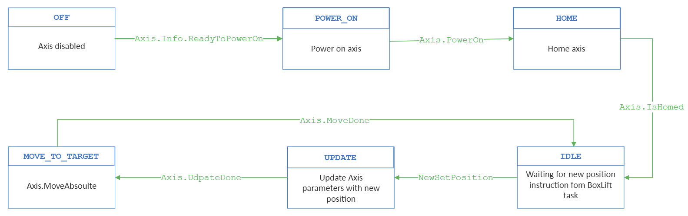

Figure 10: LiftMotion state machine without error handling

**PvMapping**

The screenshot shows which local variables of the application task (::BoxLift) from the BoxLiftSampleProject have been mapped to which variables of the SimConnect tasks (::SimConnect).

|  |  |  |
| --- | --- | --- |
|  | 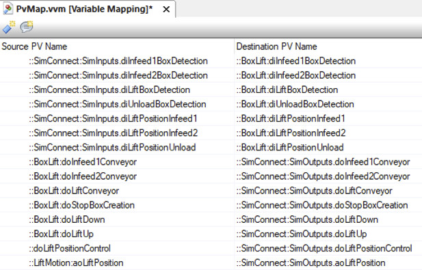  Figure 11: PvMapping in the BoxLiftSampleProject |  |

**HMI application**

A possible representation of all required elements could appear as follows:

**MainPage**

|  |  |  |
| --- | --- | --- |
|  | 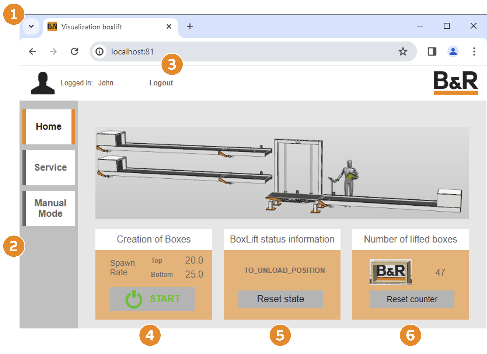  Figure 12: BoxLift HMI application main page |  |

1) The layout consists of three areas: AreaLeft, AreaHeader and AreaContent (each contains the actual page content)

2) **AreaLeft** (dark gray) contains the elements for changing pages

3) **AreaHeader** (white) contains the elements for user login/logout and the B&R logo

4) A GroupBox widget that contains a button to start and stop box production. The production rates are also displayed in the form of a NumericOutput widget.

5) Another GroupBox widget that provides information about the current state of the BoxLift state machine and contains a button that resets the state to WAIT.

6) Third GroupBox widget that displays the number of boxes already transported to the unloading conveyor belt. The "Reset counter" button can only be operated by an authenticated user.

**Service page**

|  |  |  |
| --- | --- | --- |
|  | 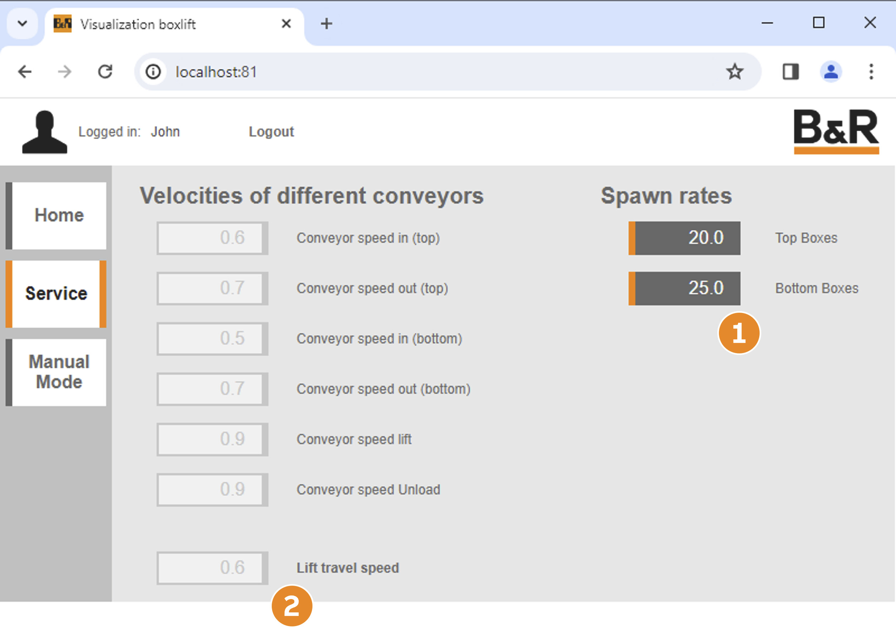  Figure 13: BoxLift HMI application service page |  |

The speeds of all conveyor belts, the lift and production frequency of the boxes are displayed on the service page. If a user with permission has successfully logged in, the NumericInput widgets can also be used for writing.

1) User "John" is logged in but only has write access to the box generation frequencies.

2) This user does not have write access to the speeds.

**Login dialog box**

|  |  |  |
| --- | --- | --- |
|  | 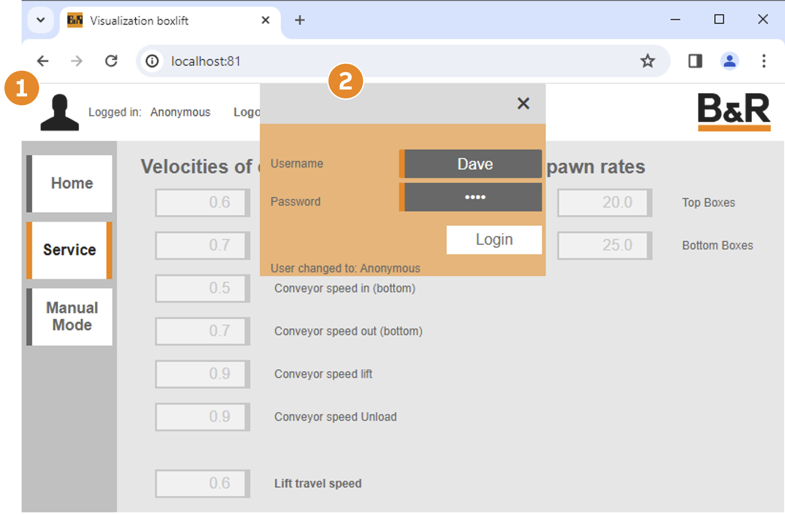  Figure 14: BoxLift HMI application login dialog box |  |

The user logs in through a login dialog box. "Anonymous" indicates that no user is currently logged in.

1) Clicking on the image in the AreaHeader opens the login dialog

2) LoginDialog can be moved on the page via drag-and-drop and closes automatically after a successful login.

|  |  |
| --- | --- |
|  |  |

|  |
| --- |
| V1.2.0.0 ©2026/05/07 by B&R, All rights reserved.  All registered trademarks are the property of their respective owners.  Subject to technical changes without notice. |